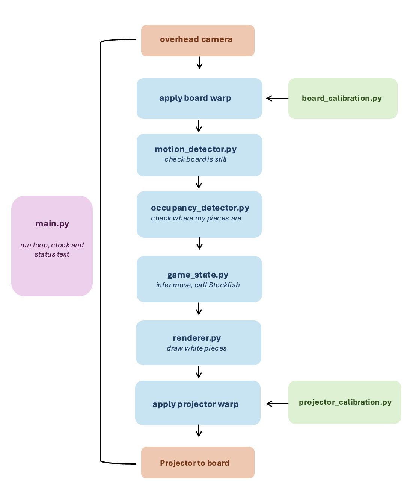
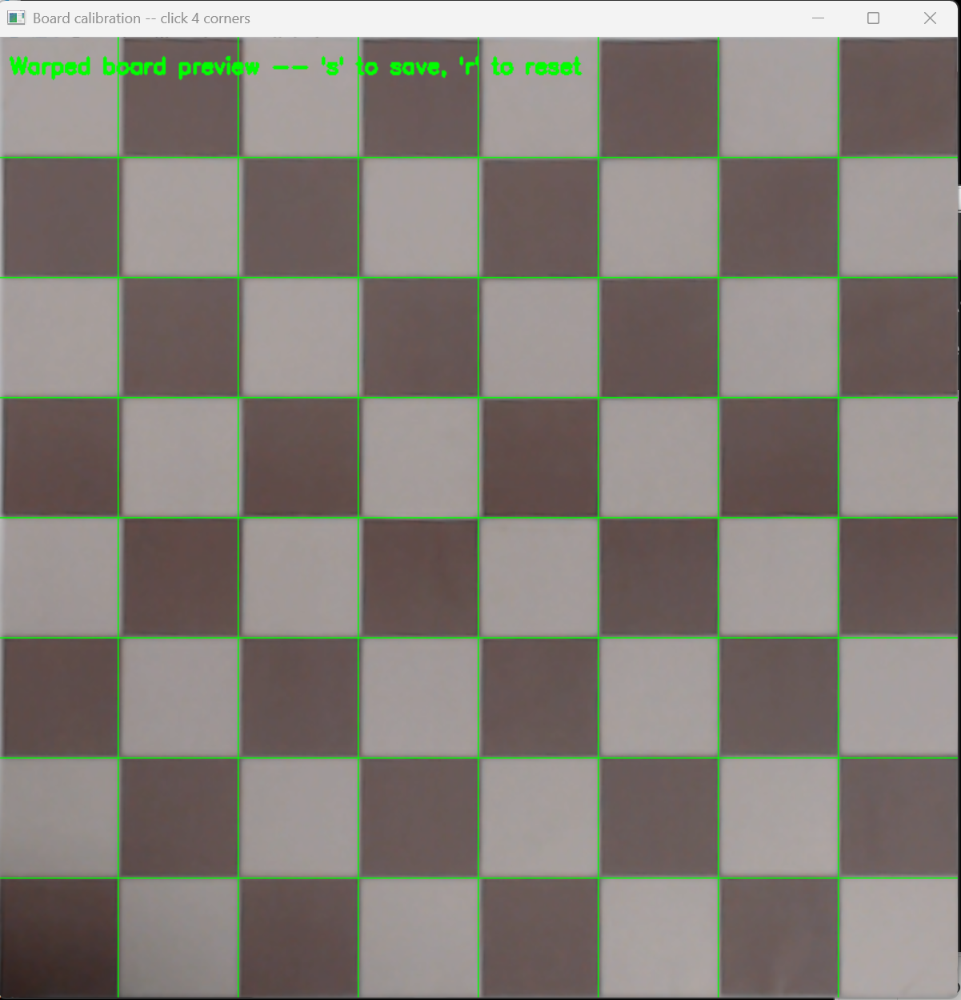
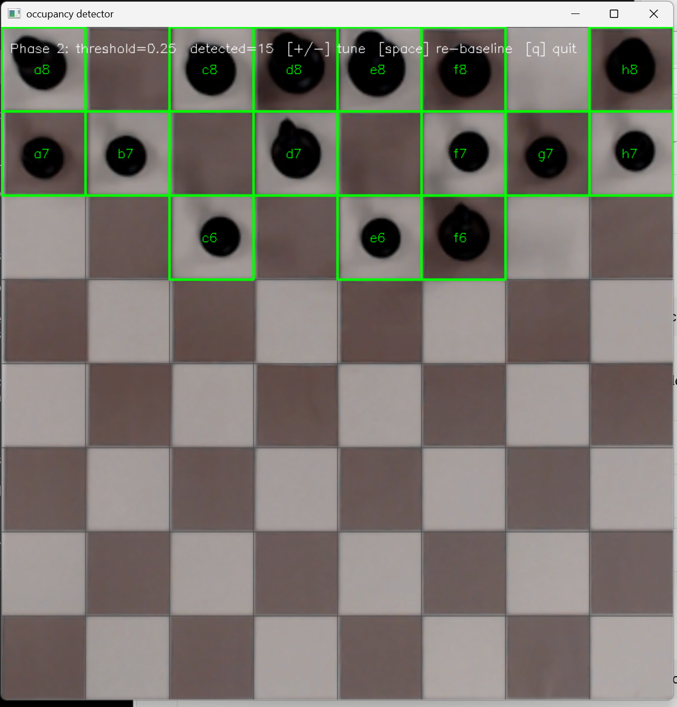
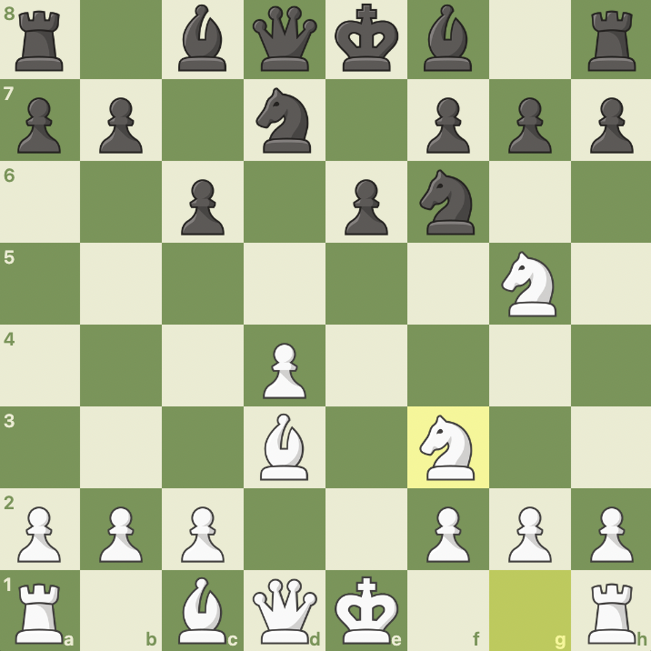
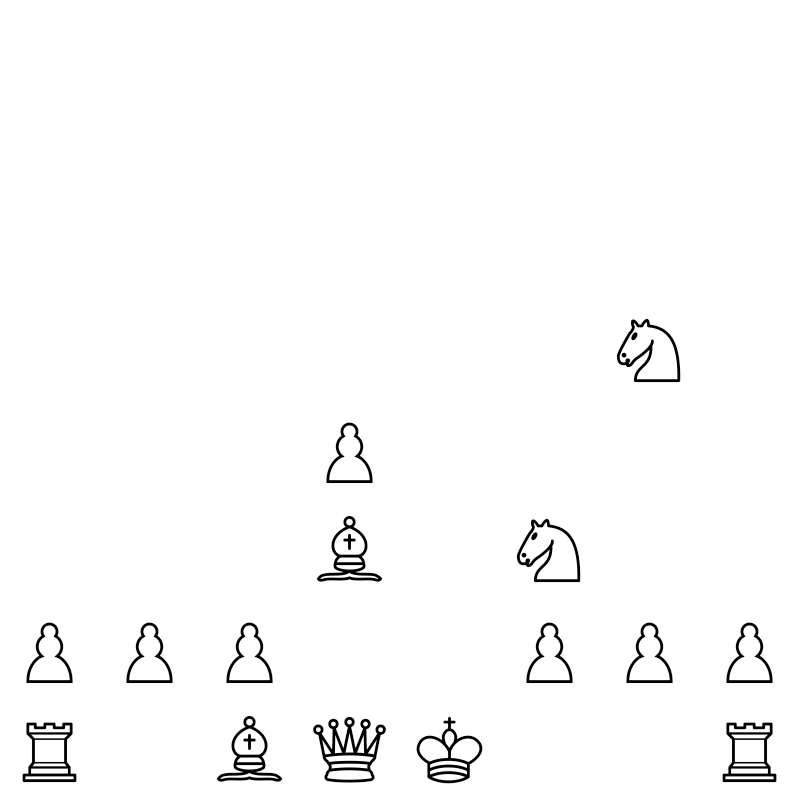
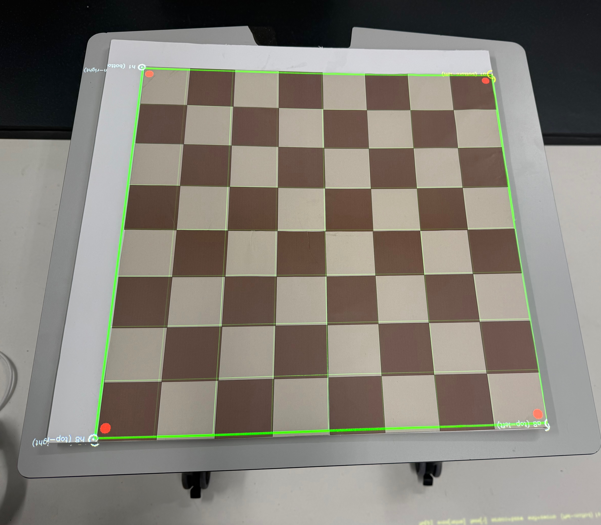
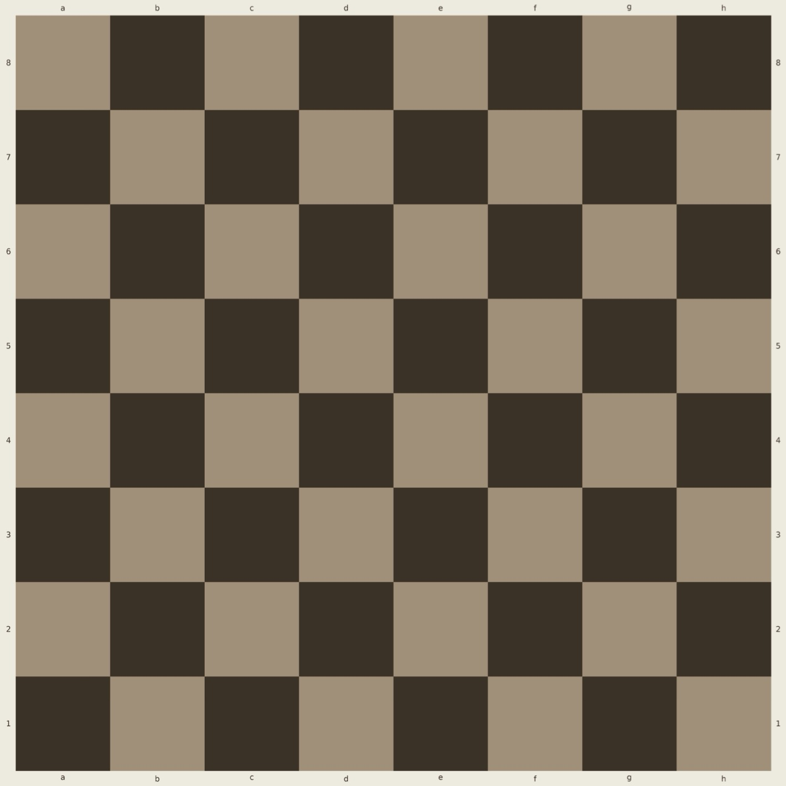
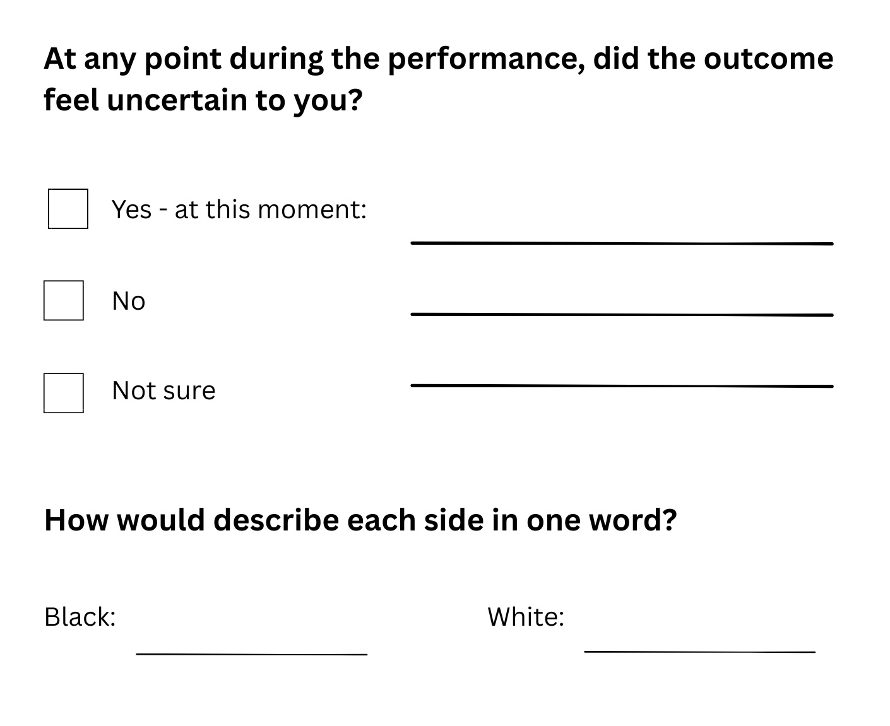
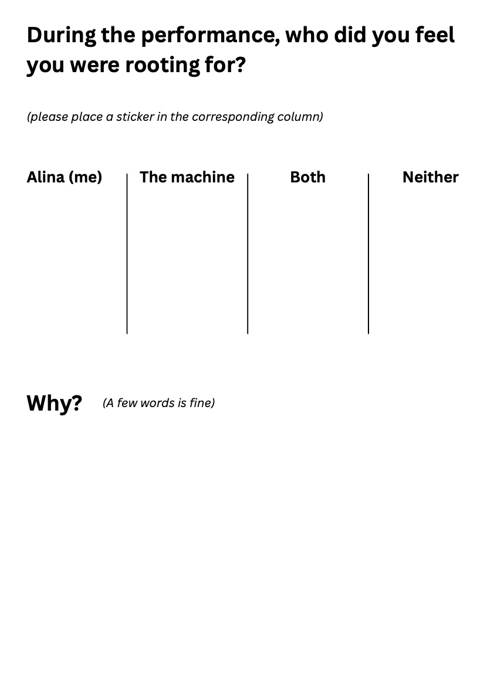
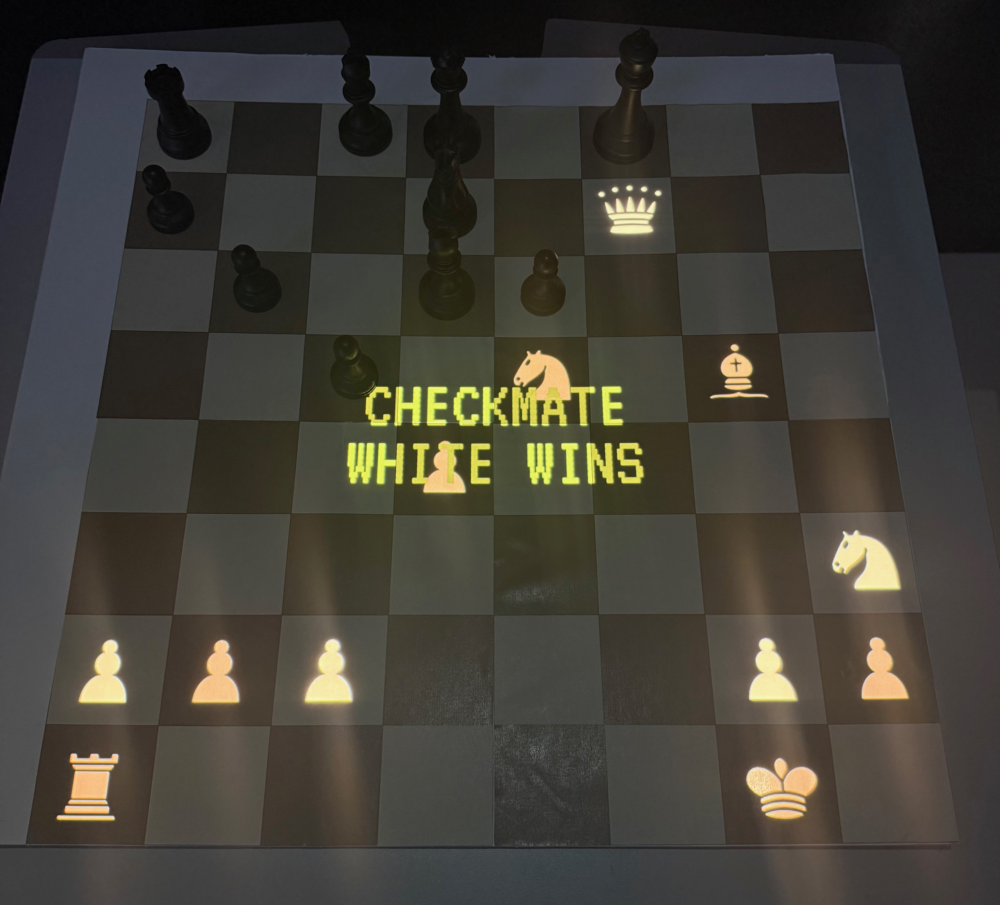

# The Rematch: Restaging Deep Blue vs Kasparov, Game 6

## 1. Introduction

*The Rematch* is a live performance restaging the sixth and deciding game of the 1997 chess match between Garry Kasparov and IBM's Deep Blue - the game Kasparov lost, marking the first time a reigning world champion was beaten by a machine in a match. I take Kasparov's seat at the position right before his seventh move, widely regarded in the chess community as the error that lost him the game, and play a different move in its place. The introduction video below, shown to the audience before the performance, gives the full historical and conceptual context for the piece.

[Watch the introduction video](https://artslondon-my.sharepoint.com/:v:/g/personal/a_kuznetsova0620251_arts_ac_uk/IQAwPAkQUn0NS4p1vyWVEnu2AVMbt3qcaJ8my8Y7NJswaLQ?nav=eyJyZWZlcnJhbEluZm8iOnsicmVmZXJyYWxBcHAiOiJPbmVEcml2ZUZvckJ1c2luZXNzIiwicmVmZXJyYWxBcHBQbGF0Zm9ybSI6IldlYiIsInJlZmVycmFsTW9kZSI6InZpZXciLCJyZWZlcnJhbFZpZXciOiJNeUZpbGVzTGlua0NvcHkifX0&e=Iw9NYN)

This reflection walks through the system I built and the technical problems I encountered along the way, then documents two live performances: a first run that failed partway through when a projection flaw disrupted the move detection, and a corrected second run that completed in full. I discuss audience feedback from the first performance and close with a reflection on the work's successes, limitations and future directions.

## 2. System & Build

The code for my performance consists of seven modules: six handle one stage each of a pipeline, and the seventh, main.py, ties them together by running the live performance loop. The actual code can be found in the chess_code folder. The flow of data between the modules is outlined in the flowchart below, followed by a more detailed explanation of each in the subsections that follow.

### 2.1 board_calibration.py

To capture the board I used a webcam mounted above it. It was impossible to get it perfectly square by positioning alone - there was always some tilt - so I used this module to correct for that in software by warping the view. Before each performance I ran it once, clicking the four corners of the board in order (a8, h8, h1, a1). OpenCV's `getPerspectiveTransform` used those four points to flatten the angled camera view into a clean top-down 800x800 image, making every square the correct shape and size. The transform was saved to the calibration folder and applied to every frame, so the rest of the pipeline always worked from a correct, consistent image of the board.

The grid overlay above is how I checked the calibration: if the green lines fall correctly between the real squares (as they do in the image above), then the warp is correct. I also set the webcam's exposure and focus through its control app before calibrating, so the squares read clearly and the board was neither too dark nor washed out for the detection stage that follows. Both the calibration and these settings were fixed at setup, and I had to ensure the camera and board did not move afterwards.

### 2.2 motion_detector.py

During the match, since the camera read the board continuously, I needed a way to tell the system when my move was actually finished. If it read the board the whole time, it could have acted on a half-finished move - for example reading a castle after I had moved the king but not yet the rook. This module therefore handled making the system read the game position only after my move was complete.

To do so, I used frame differencing: each frame was greyscaled, blurred to smooth out camera noise, and compared to the previous one. If enough had changed, that counted as motion. The reason for the blur was that even on a still board the camera flickers slightly between frames, and without smoothing that out the detector would never have registered the board as settled.

To work out when my move was finished, the detector moved through three stages: MOVING while I was moving a piece, SETTLING when the motion had just stopped, and STABLE once the board had stayed still for a full second. I included the SETTLING stage so that if I paused slightly mid-move, the short wait would stop that pause counting as a finished move. Only on reaching STABLE was the board read.

### 2.3 occupancy_detector.py

Once the board had settled, the position of my black pieces had to be read, which was done by this module, which worked out which of the 64 squares they occupied. To do this, I used brightness comparison: during setup I captured a baseline image of the empty board, storing each square's average brightness, and then on every read after a completed move it compared each square to its baseline. If a square had become noticeably darker, that meant a black piece was sitting on it. This method also shaped the board itself - I printed the dark squares to be brown rather than black, so my black pieces were darker than them.

To make detection work across the whole board (both light and dark squares) each square's drop in darkness was measured as a fraction of its own baseline: `drop = (baseline - current) / baseline`. On a dark square a black piece barely changes the brightness, so a fixed cutoff low enough to catch it could also be triggered by shadows on the lighter squares. Measuring the drop as a fraction mitigated this - a black piece on a dark square changes the brightness only slightly in absolute terms, but against that square's already-low baseline it still comes out as a clear enough drop to share a single threshold with the lighter squares.

A square counted as occupied once the its drop crossed a set threshold. I tuned this against the board in the performance lighting, settling on 0.25. This was calibrated prior to each performance, and I had to ensure the lighting in the room remained the same throughout.

*The occupancy detector's debug view: green rectangles mark the squares detected as occupied, with the black pieces in their starting positions all correctly identified.*

### 2.4 game_state.py

This module ran the chess game itself, wrapping a python-chess board and the Stockfish chess engine. Crucially, it set where the game began. Rather than the standard opening, I started the game from a specific position, as explained in my introduction, which is stored in the code as a FEN string (a standard text notation for a chess position). 

*Deep Blue vs Kasparov (1997), Game 6, immediately before Black's 7...h6. White has just played Nf3 (highlighted); Black to move.*

I set the engine to 2750 Elo, which matched Deep Blue's estimated 1997 strength, since Deep Blue model is not available to use, as it was dismantled directly after that game. I gave the engine three seconds per move, as we had been advised to aim for a performance of around five minutes. therefore, a long think time was not practical, but I did not want instant replies either - a short pause made the machine feel like it was taking time to think, which made the match feel more genuine. It is important to note that his was a personal decision and did not match Deep Blue's actual timing, which used standard tournament time controls of 40 moves in two hours. 

This module also turned what the webcam saw into an actual move. The occupancy detector only handed over a set of squares that contained black pieces, which on its own does not say what move was played. To decipher this, `infer_black_move` worked backwards, by running through every legal black move and checking which one produced the arrangement the webcam saw. Almost always, there could only be one legal move that matched, which it then identified as mine. The only exception could be a promotion, where a pawn reaching the back rank could become a queen, rook, bishop or knight (player's choice) - all four would count as different moves, but appear to the pipeline as identical occupied squares, since the detector is only able to read where pieces are. In this case, it would not have been able to identify the move, and therefore would not be able to continue the game. However, detecting piece type as well as position would have been far too complex to achieve within my time frame. Since I was playing an engine far beyond my level, I knew that me reaching a promotion was extremely unlikely, so I decided to accept this risk.

Once my move was confirmed, the engine played white's reply, which the renderer then drew and projected onto the board. 

### 2.5 renderer.py

This module produced the image of white's pieces, which were projected onto the board, by taking the current board state from `game_state.py` and drawing each white piece in its correct position. My pieces being physical while the engine's were projected was not only a practical choice but also a conceptual one: I wanted to show that I was physically present, playing against an engine existing only as a projection of intangible code.

*The renderer's output for the starting position - white's pieces on a transparent background.*

The images of the pieces were downloaded from greenchess.net and can be seen in the pieces folder. I ensured they were PNG images on a transparent background, so that they were projected with no background behind them, leaving the rest of the physical board completely visible.

### 2.6 projector_calibration.py

This module aligned the projection so that it landed correctly on the squares of the printed board. To calibrate it, I projected a test grid onto the board and moved the four corners of the projected image until they sat on the corners of the printed board beneath. This corrected the projection's position and size, and fixed any distortion from the projector not sitting perfectly above the board. I used keyboard controls to do this, and the result was saved and applied to every projected frame.

*The projected calibration grid (green) aligned on the printed board, with the red dots marking each corner.*

### 2.7 main.py

This module ran the live performance by looping through the six modules detailed above, keeping the clock, and showing status messages such as check and checkmate. On startup it loaded the three calibrations and the saved game position, then ran one loop per camera frame until the game ended. On my PC screen it showed a debug window with the detected occupancy and the moves being made, so I could watch for any issues and more easily identify them if they happened.

A few performance-level details were also added into this module:

- **Clock.** Each side had ten minutes. It switched sides as moves were made and ended the game if either side ran out of time
- **180 degree flip.** When I first projected white's pieces they came out flipped, both vertically and horizontally, relative to where I was standing. Moving to the other side would have fixed this but I was worried it could affect the already calibrated occupancy detection, by causing a slight change in lighting. Therefore I decided to rotate the projection 180 degrees before it showed, to swap the sides round manually.
- **Status overlay.** Any key game states were projected onto the board - "WHITE IN CHECK" or "BLACK IN CHECK" for a check, "CHECKMATE" with the winner for a checkmate, and "TIME" with the winner if a clock ran out. However, this actually proved to cause a significant issue in performance 1, which I explain in section 4.

## 3. The Board Problem

Having explained how the finished system works, it is worth going back to one problem that shaped a large part of it. The board shown in Section 2 is not the one I started with - my original board had darker brown squares than the one I ended up using:

When I made it, I assumed these brown squares would work fine for the occupancy detection, since my pieces were black - however, they proved to be too dark. When I tried to tune the detection, it was impossible to find a threshold that worked reliably, since the difference between an empty and an occupied dark square just was not strong enough.

At first I was determined to fix it in software, but each solution ended up resulting in other problems arising. For example, I tried measuring the "texture" of each square rather than its brightness - the idea being that a piece creates variation across a square, with some darker crevices and lighter reflections, while an empty square is more uniform. The issue with this was that the projected white pieces created variation too, so the detector could not tell my physical pieces from the projection.

To get around that, I tried simply not reading any square that had a white piece projected on it. This seemed to work, until it reached a capture. When I tried to capture a white piece, my black piece moved onto the square the white piece had been on - but since this was a white-piece square, the detector was ignoring it, and therefore the capture was not being detected.

Eventually I accepted that the best fix was to reprint the board with lighter dark squares - this updated board is the one visible in the calibration and detection images earlier in this document. On testing, this solved the problem, and the proportional darkness measure from Section 2.3 worked across the whole board. Knowing when to stop adjusting the code and fix the physical setup instead was a useful lesson learnt. 

## 4. Performance 1 - The Failure

Luckily I had fixed the board problem during practice, so everything was working smoothly - or it was, until I came up with an idea I really wanted to add the night before. As you can guess, this ended up sabotaging my first performance, and teaching me yet another lesson: if you are going to add something, test every variation of it thoroughly.

The idea was to project illuminated text onto the board announcing check and checkmate, so the audience would have a visual cue for what was happening, and could more easily follow the game. I did of course test this prior to the performance - the check text projected and everything seemed to work, so I thought it was a good idea to include it.

When it came to the real performance, however, something I had not thought about happened. At a point where I was in check, the projected text landed over one of my pawns and stopped it from being detected - the square no longer crossed the darkness threshold, so the detector did not read the pawn. With a piece missing from the reading, the engine could not see a legal position, so it would not make white's move, and the game could not continue.

The reason I had not anticipated this was that the white pieces had always projected over my black pieces without any problem, so I had subconsciously assumed projected light over a piece was simply not an issue. What I had not considered was that the white pieces were fairly dim, whereas I had deliberately made the status text large and bright so it was easy to read - forgetting that this brightness would affect the darkness threshold.

Admittedly, when this happened, I panicked slightly and quit the game. Looking back, I could have handled this better - for example, by resigning, since the fault was in my own code rather than the game itself, which would have ended the performance on my own terms instead of just breaking it off. That said, before the error the game had been going smoothly, and for a while it felt genuinely even - it had lasted far longer than any of my practice games (over 4 minutes), which made the error even more discouraging. The recording of this performance can be viewed here:

[Watch Performance 1](https://artslondon-my.sharepoint.com/:v:/g/personal/a_kuznetsova0620251_arts_ac_uk/IQBh2FPaUr_fRaCtPgtBLsgJActeEgVRGPPDDRZ4QO66pgg?nav=eyJyZWZlcnJhbEluZm8iOnsicmVmZXJyYWxBcHAiOiJPbmVEcml2ZUZvckJ1c2luZXNzIiwicmVmZXJyYWxBcHBQbGF0Zm9ybSI6IldlYiIsInJlZmVycmFsTW9kZSI6InZpZXciLCJyZWZlcnJhbFZpZXciOiJNeUZpbGVzTGlua0NvcHkifX0&e=YcEIWy)

### 4.1 Audience Feedback

Even though I had to cut Performance 1 short, I still collected audience feedback afterwards. I chose to still do this as firstly, the performance ran for over four minutes before it failed, which gave the audience enough time to form opinions and provide valuable evaluation insights. Secondly, this run actually captured a specific case - how people interpret a performance where the system visibly breaks - which turned out to reveal some interesting insights of its own.

To collect this feedback I used two formats, both designed to be short and quick to encourage audience members to actually take part. The first was a paper slip handed out after the performance, asking whether the outcome ever felt uncertain and at what moment, and also for a one-word description of each side:

The second was an A3 sheet of paper that I stuck on the wall, asking people to place a sticker to illustrate who they had been rooting for - me, the machine, both or neither:

The clearest result was who people rooted for. Of those who answered, eleven were rooting for me and five for both sides, while nobody rooted for the machine alone. The one-word descriptions of each side add some insight as to why. Black, the side I played, was described with words like "defending", "introspective", "wary" and "fair and wise". On the other hand white, the machine, was described as "attacking", "calculated" and "confident" as well as "cheating" (multiple times), "unpredictable and unfair" and "glitching". This highlighted that the audience did not read the two sides as neutral - they seemed to perceive the machine as some kind of antagonist that was unfairly and strongly attacking me.

The interesting part is that I can infer that the "cheating" and "glitching" responses were reactions to the failure in particular - the moment the system stopped registering my move. Several people named that exact moment as when the outcome felt uncertain: "when the black couldn't take the white piece" and "when it didn't register the move". There was no evidence in the responses that the audience read this as the performance breaking - rather, they read it as the machine behaving unfairly, cheating or glitching. The breakdown I experienced as a technical failure, the audience largely interpreted as the machine's behaviour.

However, I want to make clear that I do not think the failure improved the piece in any way - it cut my performance off halfway through, which is never a good thing. What it did produce was a genuine finding: the malfunction was not read as one by the audience, but rather as an untrustworthy machine. This is particularly interesting as it echoes the real history of the match, when after Game 2 Kasparov accused IBM's Deep Blue of cheating (Silver, 2015), highlighting how readily we project intent and suspicion onto machines, perhaps because we do not fully understand how they operate.

## 5. Performance 2 - The Fix

For the second performance I wanted to keep the check and checkmate status text, but fix it so it did not interfere with the occupancy detection. The fix turned out to be fairly simple - I made the text smaller and dimmer, so that even when it fell across a square it no longer raised the brightness enough to hide a black piece from the detector. It still read clearly, but no longer overpowered the board underneath.

[Watch Performance 2](https://artslondon-my.sharepoint.com/:v:/g/personal/a_kuznetsova0620251_arts_ac_uk/IQAGXe-bZ195QJhbnmFkymVqAbXmeub4PVAC2Nj-PAix6G4?nav=eyJyZWZlcnJhbEluZm8iOnsicmVmZXJyYWxBcHAiOiJPbmVEcml2ZUZvckJ1c2luZXNzIiwicmVmZXJyYWxBcHBQbGF0Zm9ybSI6IldlYiIsInJlZmVycmFsTW9kZSI6InZpZXciLCJyZWZlcnJhbFZpZXciOiJNeUZpbGVzTGlua0NvcHkifX0&e=hGASoO)

With that change in place, the second run completed in full, ending with the engine putting me in checkmate. The full game lasted around three minutes, which was shorter than Performance 1 had run even without finishing - in my opinion, this time the engine attacked more aggressively. Again, this loss was expected: I am a decent chess player, but nowhere near the level of a grandmaster, so a 2750 Elo engine was far stronger than me. The point of the piece, however, was never to beat the machine, but to replay the game from before Kasparov's 'mistake' and see how else it could unfold - and this run let that happen from start to finish, without the system breaking.

Unfortunately I was not able to collect audience feedback for this run. There was no class time available to perform it again in front of an audience, and I also needed time to fix the text issue first, so I ended up redoing it alone in my own time. This was a shame, as it meant I could not evaluate how people experienced the fully completed piece - and arguably it technically stopped being a performance at all since there was noone to perform for. Nethertheless, completing the full game from start to finish was an achievement in itself.

## 6. Critical Reflection

The piece sits within what Steve Dixon (2007) calls digital performance: the incorporation of computer technology and new media into the performing arts. Dixon identifies how digital media has been increasingly built into live performance, resulting in the emergence of a new type of media. To analyse this, he considers changes in the representation of the body, space and time, including virtual bodies, digital doubles and robot performance. My work fits within this, using a computer-vision and projection system to place a live performer and a digital opponent against eachother in the same live event - I was physically present at the board, while the engine existed only as projected light and code.

Overall, I achieved what I had set out to do with this piece: to restage the most famous machine-versus-human chess match of all time, and to replay it differently from the moment of Kasparov's 'mistake' to see how else it could unfold. Although the first performance failed partway through, the failure produced genuinely valuable insights that I might not have gathered from a singular clean run. I was able to find and fix the fault and then perform the piece in full, from the first move to checkmate, which each module successfully completing its role. Much of what I learned came from this iterative process of hitting a problem and working out the best way to solve it - for example changing the board.

While I did get the system working from start to finish, it was fragile. Once the calibrations were set I could not move the board or projector, or change the lighting, without affecting the detection, which left little room for error during the live performances. While the lighting was a constraint, it also pointed me towards where I would take the piece next. After the second performance, someone using the Dark Lab (where I did my performances) asked to turn the lights off, and for the first time I saw what the board looked like in the dark:

*Post performance 2, where white put me in check.*

In the dark the projected pieces stood out far more, with a retro-like quality that in my opinion well-suited the 1997 history that my piece restages. A clear next step would be to rebuild the detection to work in low light, so the performance could run in near-darkness with the projection as its main source of light. This would require a different way of detecting the pieces, perhaps by adding detection markers to the pieces themselves, or using a depth or infrared camera that does not depend on visible light. 

## LLM Statement 

Throughout this project I used Claude (Anthropic's LLM) to assist me with writing and debugging parts of the code - the direction, design decisions and ideas were my own. I also asked it to read through this reflection to correct grammar and improve clarity and flow, while keeping the tone, content and ideas entirely my own.

## References

https://greenchess.net/info.php?item=downloads (site I downloaded the chess piece images from)

Silver, A. (2015) Deep Blue's cheating move. ChessBase. Available at: https://en.chessbase.com/post/deep-blue-s-cheating-move (Accessed: 15 June 2026).

Dixon, S. (2007) Digital Performance: A History of New Media in Theater, Dance, Performance Art, and Installation. Cambridge, MA: The MIT Press. Available at: https://mitpress.mit.edu/9780262042352/digital-performance/ (Accessed: 15 June 2026).

